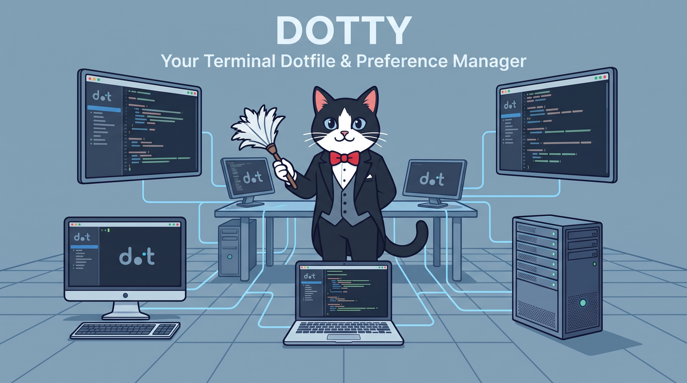

# dotty ⣿

<p align="center"></p>

**dotty keeps your dotfiles tidy.** One command turns any Mac or Linux box into
*your* machine (packages, shell, aliases, prompt, terminal) and keeps every
machine in sync afterward with two words: `dotpush` and `dotpull`.

This repo is the **template**: machinery plus an example preference set, and no
one's personal dots. On first install, dotty offers to capture *your* current
preferences as the starting point.

## Get started

1. Click **Use this template** to create your own copy (keep it **private**:
   it will hold your configs). Or fork/clone, same idea.
2. On any machine:

   ```sh
   git clone git@github.com:YOURNAME/dotty.git ~/.dotty && ~/.dotty/bootstrap.sh
   ```

3. First run, dotty asks how to begin:
   - **capture** (default): imports your existing `~/.zshrc` / `~/.bashrc` /
     ghostty config and your installed packages (Brewfile dump on macOS,
     human-installed apt packages on Debian/Ubuntu) as your starting payload
   - **example**: a sane, generic baseline (see `example/`)
   - **blank**: minimal stubs

   It commits your starting dots, installs everything, symlinks your rc files
   into the repo, and hands you a fresh shell.

Idempotent to a fault: running bootstrap again is boring, which is the point.

## Daily driving

Your rc files are symlinks into `~/.dotty`, so editing config *is* editing the
repo.

| you did | now run | what happens |
|---|---|---|
| added an alias, installed a package | `dotpush` | Brewfile re-dumped (macOS) / human-installed apt packages captured (Linux), everything committed (with a secret check), rebased, pushed |
| another machine pushed | `dotpull` | pulls, re-runs the installer, restarts your shell, reports the new dots |

`dotpush` takes an optional commit message: `dotpush added ripgrep`. In Claude
Code, `/dotty-save` is the smarter dotpush: it reviews the diff, curates package
changes, and folds in anything you describe in words.

## What the installer does

- **macOS**: Homebrew if missing, then `brew bundle`
- **Linux (Debian/Ubuntu)**: `apt` packages from `packages/apt.txt` + GitHub CLI
- Sets your preferred shell (`PREFERRED_SHELL` in `dotty.conf`: zsh or bash) as
  the default. **oh-my-zsh** installs only if `WANT_OH_MY_ZSH=yes`. **nvm**
  installs either way.
- Symlinks `~/.zshrc`, `~/.zprofile`, `~/.bashrc`, `~/.bash_profile`, and
  `~/.config/ghostty/config` into the repo (anything already there is saved as
  `*.bak`). Aliases and portable env live in `shell/common.sh` (POSIX sh),
  sourced by both shells. Directories under `.claude/skills/` are linked into
  `~/.claude/skills/`.

Anything machine-specific (work-only env vars, one-off paths) goes in
`~/.zshrc.local` / `~/.bashrc.local`: sourced last, never tracked. Git config is
deliberately *not* managed; your identity shouldn't ship with your dotfiles.

## The curl one-liner (optional)

To bootstrap brand-new machines without cloning first, point the two `REPO_*`
lines in `bootstrap.sh` at your repo, mirror the script as a public gist
(`gh gist create --public bootstrap.sh`), and put the gist id in `dotty.conf`'s
`BOOTSTRAP_GIST_ID` (dotpush re-mirrors it on changes). Then your one line is:

```sh
curl -fsSL https://gist.githubusercontent.com/YOURNAME/GIST_ID/raw/bootstrap.sh | sh
```

It handles GitHub auth on its own: SSH keys, the 1Password SSH agent on Macs
(even before your shell config is installed), and an https credential prompt as
the last resort.
